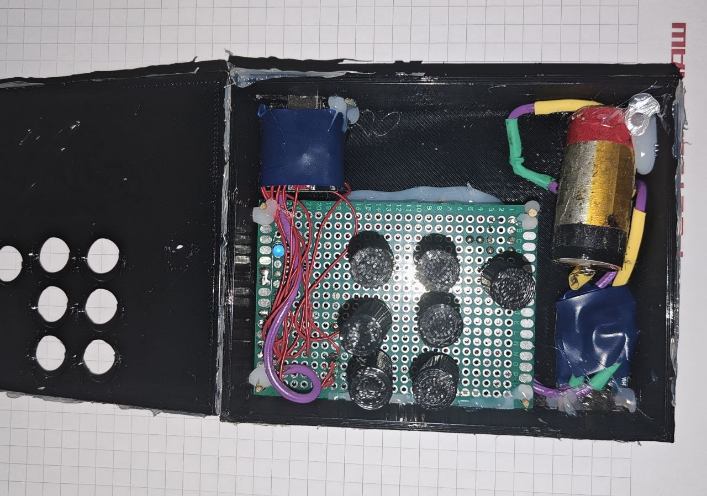
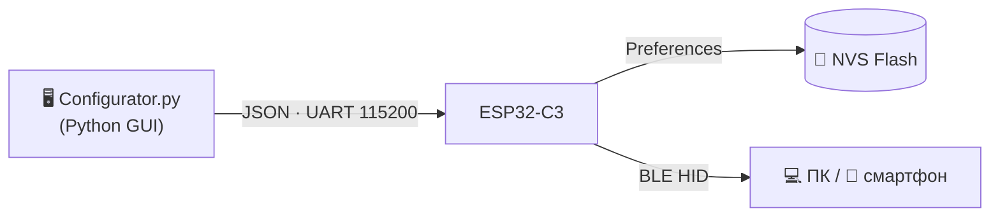
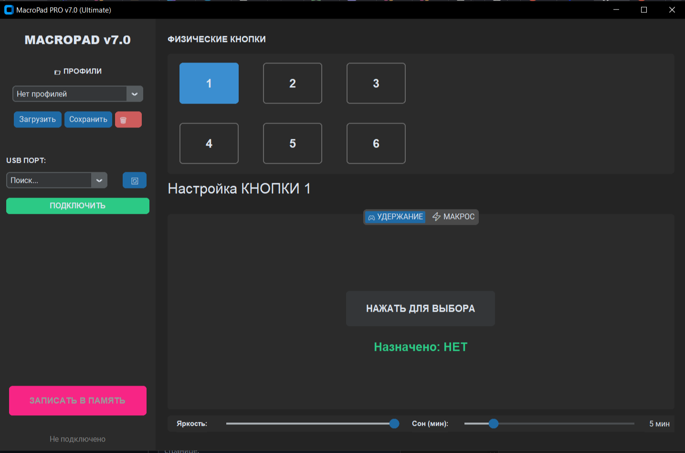

# 🎹 BLE MacroPad на ESP32-C3

> Беспроводная макро-клавиатура: 6 программируемых клавиш, Bluetooth HID,
> глубокий сон, аккумулятор с зарядкой и настольный GUI-конфигуратор.


<p align="center">
  
  <!-- 📸 Добавьте сюда фото готового устройства или GIF с работой -->
</p>

Устройство притворяется обычной Bluetooth-клавиатурой — **никаких драйверов**:
спроектировал схему, написал прошивку и конфигуратор, спаял — и макропад работает
с любым ПК, ноутбуком или телефоном.

---

## ✨ Возможности

- 🔵 **Полностью беспроводной** — BLE HID, подключается как стандартная клавиатура
- 🎮 **6 клавиш × 2 режима**: «Удержание» (hold) и «Макрос» (до 30 действий на клавишу)
- ⚡ **Гибкие макросы**: нажать / отпустить / задержка в мс + медиаклавиши (Play/Pause, громкость, треки)
- 🔋 **Энергонезависимая логика питания**: глубокий сон, пробуждение любой кнопкой, софт-выключение без разрыва цепи
- 💡 **LED-индикация состояний**: поиск, подключение, нажатие, режим настройки
- 🖥️ **GUI-конфигуратор для ПК**: запись клавиш прямо с клавиатуры, профили, пресеты `Ctrl+C / Ctrl+V / Ctrl+Z / Win+D`
- 💾 **Хранение конфигурации в NVS** — настройки переживают выключение и перезагрузку
- 🔧 **Настройка по USB-UART** через открытый JSON-протокол, яркость меняется в реальном времени

---

## 🛠️ Железо

Схема спроектирована с нуля: кнопки, светодиодная индикация, зарядка и питание.

### Компоненты

| Компонент | Кол-во | Назначение |
|---|---|---|
| ESP32-C3 (SuperMini) | 1 | МК с BLE 5.0 |
| Тактовые кнопки | 6 | Макроклавиши (матрица 3×2) |
| Кнопка питания | 1 | Софт-вкл/выкл, wake-up |
| RGB-светодиод | 1 | Статусная индикация (PWM) |
| TP4056 (с защитой) | 1 | Зарядка аккумулятора |
| Li-Ion аккумулятор 3.7 В | 1 | Питание |

### Распиновка

| Назначение | GPIO | Подключение |
|---|---|---|
| Клавиши 1–6 | `3, 5, 0, 4, 7, 10` | На GND, внутренний `INPUT_PULLUP` |
| Кнопка питания / wake | `1` | На GND |
| Статусный LED | `6` | PWM (`analogWrite`) |

```text
┌─────┬─────┬─────┐
│  1  │  2  │  3  │   GPIO 3, 5, 0
├─────┼─────┼─────┤
│  4  │  5  │  6  │   GPIO 4, 7, 10
└─────┴─────┴─────┘
```

---

## 🏗️ Архитектура



1. Конфигуратор читает и пишет настройки по COM-порту (JSON построчно).
2. Прошивка сохраняет конфигурацию в NVS и перезагружается в режим клавиатуры.
3. Дальше устройство автономно — ПК видит обычную Bluetooth-клавиатуру.

---

## 📡 Прошивка

### Режимы клавиш

| Режим | Поведение |
|---|---|
| 🎮 **Удержание** | Клавиша зажата → модификатор держится, отпущена → отпускается (Ctrl/Shift, игры) |
| ⚡ **Макрос** | По нажатию проигрывается последовательность `press → delay → release` |

### Индикация

| Состояние | Поведение LED |
|---|---|
| Режим конфигуратора | Статичное свечение (удобно выставить яркость) |
| Поиск устройства | Плавное «дыхание» |
| Подключено | Короткая вспышка раз в 5 секунд |
| Нажатие клавиши | Вспышка 150 мс |
| Выключение | Плавное затухание → сон |

### Питание и сон

- ⏱️ **Таймер сна** настраивается (по умолчанию 5 мин, `0` — отключить)
- 😴 **Deep sleep** с пробуждением по **любой** клавише (`esp_deep_sleep_enable_gpio_wakeup`)
- 🔘 **Софт-питание**: удержание кнопки > 2 с — плавное затухание LED и уход в сон,
  без разрыва цепи питания и без лишнего тумблера
- 🛡️ **Safe boot**: зажать клавишу 1 при включении → принудительный режим конфигуратора
  (спасти устройство можно всегда, даже с «плохим» макросом)
- ✅ Антидребезг кнопок (20 мс), конфиг с magic-byte и дефолтами при первом старте

---

## 🖥️ Конфигуратор

<p align="center">
  
  <!-- 📸 Скриншот окна программы -->
</p>

Тёмная тема на **CustomTkinter**:

- Визуальная матрица 3×2 — клик по кнопке открывает её редактор
- **Запись клавиш с клавиатуры**: нажал «Выбрать» → нажал нужную клавишу — готово
- Редактор макросов: тип действия, клавиша, задержка; удаление строк
- Быстрые пресеты: `Ctrl+C`, `Ctrl+V`, `Ctrl+Z`, `Win+D`
- 📁 **Профили**: сохранение / загрузка / удаление наборов макросов (JSON)
- Автопоиск COM-портов, проверка связи `ping`, **авточтение конфига с устройства**
- Ползунки яркости (применяется мгновенно) и таймера сна
- Одна кнопка **«Записать в память»** — и устройство перезагружается с новыми настройками

---

## 🚀 Быстрый старт

1. Зажмите **клавишу 1** и включите питание → LED горит ровно = режим настройки
2. Запустите конфигуратор → выберите COM-порт → **Подключить**
3. Настройте клавиши, яркость, таймер сна
4. **«Записать в память»** — устройство сохранится и перезагрузится
5. Подключите **«ESP32 MacroPad»** в настройках Bluetooth — готово 🎉

Готовые файлы лежат в [Releases](https://github.com/AV4KADA/esp32-macropad/releases)
---

## 🔌 Протокол обмена (JSON over UART, 115200)

| Команда | Описание |
|---|---|
| `ping` | Проверка связи |
| `get_config` | Запрос конфига → `config_data`, `macro_data` ×6, `config_end` |
| `set_settings` | Яркость (`brightness`, 0–255) и таймер сна (`sleep`, мс) |
| `set_macro` | Запись макроса кнопки |
| `save` | Сохранить в NVS и перезагрузиться |
| `reset` | Сброс к заводским настройкам |

Пример — `Ctrl+C` на клавишу 1:

```json
{"cmd": "set_macro", "button": 0, "mode": 0, "actions": [
  {"t": "press",   "k": 128, "v": 0},
  {"t": "press",   "k": 99,  "v": 0},
  {"t": "delay",   "k": 0,   "v": 50},
  {"t": "release", "k": 99,  "v": 0},
  {"t": "release", "k": 128, "v": 0}
]}
```

`t` — тип действия (`press` / `release` / `delay`), `k` — код клавиши, `v` — задержка в мс (0–65535).

---

## ⌨️ Поддерживаемые клавиши

`A–Z` · `0–9` · `F1–F5` · `Enter / Esc / Tab / Space / Backspace` · стрелки ·
все модификаторы (`Ctrl / Shift / Alt / Win`, левые и правые) ·
медиаклавиши: `Play/Pause`, `Vol+`, `Vol−`, `Mute`, `Next`, `Prev`

---

## 🗺️ Планы

- [ ] Мониторинг заряда аккумулятора (ADC)
- [ ] WS2812-подсветка с эффектами
- [ ] OLED-дисплей: статус и активный профиль
- [ ] Энкодер громкости
- [ ] Слои / больше макросов
- [ ] Сборка конфигуратора в `.exe` (PyInstaller)

---

## 📄 Лицензия

[MIT](LICENSE) — используйте, форкайте, собирайте своё.

<p align="center">Сделано с ❤️ и паяльником</p>
